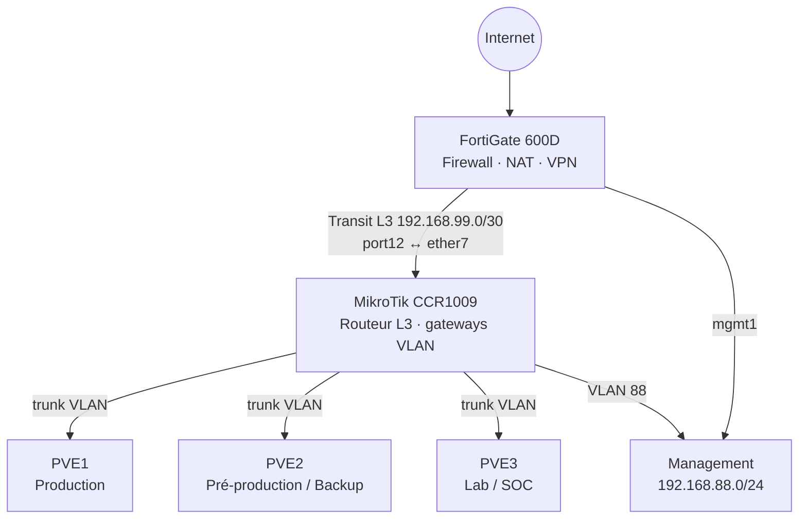

# Infrastructure PME sécurisée — projet de lab

Infrastructure de type PME construite en homelab : virtualisation Proxmox, segmentation VLAN, routage L3 MikroTik, pare-feu FortiGate, sauvegarde et supervision de sécurité.

> Projet personnel d'apprentissage et de démonstration. Les adresses sont toutes privées (RFC 1918).

## Objectifs

- Séparer les rôles : **routage** (MikroTik) et **filtrage / NAT / accès Internet** (FortiGate)
- Segmenter le réseau par usage (utilisateurs, serveurs, sauvegarde, lab, SOC, applications, bases de données)
- Filtrer les flux **entre VLAN** au niveau du pare-feu
- Isoler l'administration sur un VLAN de management dédié

## Architecture

| Équipement | Rôle |
|---|---|
| FortiGate 600D | Pare-feu, NAT, WAN, VPN, filtrage inter-VLAN |
| MikroTik CCR1009 | Routeur L3, passerelles des VLAN, routage inter-VLAN |
| Proxmox PVE1 / PVE2 / PVE3 | Production / Pré-production et backup / Lab et SOC |
| Proxmox Backup Server | Sauvegarde des VM (VLAN 30) |
| Ceph | Stockage distribué du cluster Proxmox (3 nœuds, 6 OSD) |
| Wazuh, Splunk | SIEM / HIDS : en cours d'apprentissage (VM Wazuh créée sur le VLAN 50, déploiement à venir ; Splunk prévu) |

**Principe** : le CCR est la passerelle de tous les VLAN 10 à 70. Le FortiGate n'est pas leur passerelle : il reçoit le trafic via un lien de transit L3 dédié, applique les politiques puis sort sur Internet.

## Plan d'adressage

| VLAN | Nom | Réseau | Passerelle (CCR) |
|---|---|---|---|
| 10 | USERS | 10.0.10.0/24 | 10.0.10.1 |
| 20 | SERVERS | 10.0.20.0/24 | 10.0.20.1 |
| 30 | BACKUP | 10.0.30.0/24 | 10.0.30.1 |
| 40 | LAB | 10.0.40.0/24 | 10.0.40.1 |
| 50 | SOC | 10.0.50.0/24 | 10.0.50.1 |
| 60 | APP | 10.0.60.0/24 | 10.0.60.1 |
| 70 | DB | 10.0.70.0/24 | 10.0.70.1 |
| 88 | MGMT | 192.168.88.0/24 | 192.168.88.1 |

## Stockage distribué Ceph

Le cluster Proxmox utilise Ceph pour le stockage partagé :

- **3 nœuds** (PVE1, PVE2, PVE3)
- **2 OSD par nœud**, soit **6 OSD** au total
- Intégration native à Proxmox VE : le stockage est partagé entre les nœuds du cluster

## Lien de transit CCR ↔ FortiGate

- FortiGate `port12` : 192.168.99.1/30 — CCR `ether7` : 192.168.99.2/30
- `ether7` n'est ni dans le bridge ni un trunk : lien **L3 uniquement**
- Routes : CCR `0.0.0.0/0 → 192.168.99.1` ; FortiGate `10.0.0.0/8 → 192.168.99.2`
- Le réseau 192.168.88.0/24 est directement connecté au FortiGate (interface `mgmt1`) : aucune route statique vers le CCR pour ce réseau

## Flux et filtrage

Le trafic inter-VLAN traverse le pare-feu : `VLAN → CCR → FortiGate → politique → CCR → VLAN de destination`.

- **Internet** : politique unique avec NAT sur le FortiGate ; les VLAN BACKUP (30) et DB (70) n'ont pas d'accès Internet
- **APP → DB** : TCP 3306 (MySQL) uniquement
- **SERVERS ↔ BACKUP** : NFS, SMB, SSH, HTTPS, Proxmox Backup Server
- **USERS → SERVERS / APP / DC** : services nécessaires (NTP, HTTPS, DHCP, Active Directory)
- **LAB** isolé des environnements sensibles
- **Administration** : groupes d'objets dédiés (infrastructure, postes d'administration)

## Services déployés

| Service | VLAN |
|---|---|
| Contrôleurs de domaine (2), WSUS | 20 |
| Proxmox Backup Server | 30 |
| MySQL, MSSQL | 70 |
| Application de production | 60 |
| VM Wazuh (créée, déploiement en cours) | 50 |
| VM de test | 40 |

## Validation

- Ping CCR ↔ FortiGate sur le transit, sans perte
- Accès Internet depuis le FortiGate puis depuis le CCR
- Accès de management au CCR et au FortiGate depuis le VLAN 88
- Vérification de la route par défaut et des VLAN taggés / untaggés sur le bridge

## Retours d'expérience

- **Séparer management et transit** : l'administration du FortiGate passe par `mgmt1`, le transit uniquement par `port12` / `ether7`. Cela évite les conflits de routage et facilite le diagnostic.
- **Éviter le double routage L3** entre CCR et FortiGate : une seule route par défaut et une seule route de retour.
- **Vérifier les ports d'administration** : un service d'administration web peut écouter sur un port non standard, et le 443 peut être pris par le VPN SSL.
- **Contrôler les objets du pare-feu** avant de les réutiliser : le nom d'un objet ne garantit pas son contenu.

## Compétences mises en œuvre

Proxmox VE · VLAN et trunks · routage L3 MikroTik · FortiGate (NAT, politiques, objets, VPN) · Active Directory · WSUS · Ceph · Proxmox Backup Server · documentation d'architecture

## Pistes d'évolution

- Schéma d'architecture détaillé et exports de configuration anonymisés
- Automatisation du déploiement avec Ansible / Terraform
- Déploiement et configuration de Wazuh (agents, règles d'alerte), puis de Splunk
- Durcissement : durcissement des accès d'administration, journalisation centralisée
